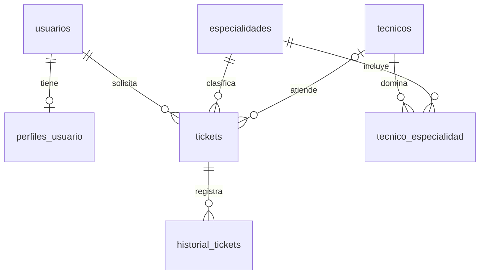

# Mesa de ayuda TI

**Estudiante:** Demis Ramírez (verifica el nombre que debes usar en la entrega).

Aplicación de escritorio para registrar solicitudes de soporte, asignarlas a técnicos y consultar su avance. Evita perder solicitudes en correos o conversaciones informales y permite revisar los cambios de estado.

## Funciones

- Alta de usuarios junto con su perfil y alta de técnicos con una especialidad.
- Registro, consulta, modificación y eliminación de tickets.
- Búsqueda por título o solicitante y filtro por estado.
- Asignación de técnicos mediante un procedimiento almacenado que exige la especialidad correspondiente.
- Historial automático de cambios de estado mediante un trigger.
- Vista de tickets con `JOIN` y resumen por estado con `GROUP BY`.
- Mensajes de éxito y errores de validación o conexión.

## Tecnologías

Python 3.11 o 3.12, Flet 0.24.1, MySQL 8, MySQL Connector/Python, python-dotenv, DBeaver y Git/GitHub.

## Modelo de datos

| Relación | Implementación |
| --- | --- |
| 1:1 | `usuarios.id` → `perfiles_usuario.usuario_id` (clave primaria y foránea) |
| 1:N | `usuarios.id` → `tickets.usuario_id`; un solicitante crea varios tickets |
| N:M | `tecnicos` ↔ `especialidades` mediante `tecnico_especialidad` |

También existen claves foráneas desde tickets a técnicos y especialidades, e historial a tickets. Las restricciones de unicidad protegen los correos. Las claves foráneas impiden referencias inexistentes. El perfil se crea a la vez que el usuario desde la interfaz; así los usuarios creados por la aplicación tienen exactamente uno.



## Instalación paso a paso (Windows)

1. Conéctate al servidor MySQL desde DBeaver y selecciona la base que ya tienes asignada. En `.env`, `DB_NAME` debe ser **exactamente ese nombre**. Si todavía no tienes una base, créala primero desde DBeaver con un usuario que tenga permiso para hacerlo.
2. Abre `sql/01_tablas.sql` en el editor SQL de DBeaver **sobre esa base seleccionada** y ejecuta el script completo (Alt+X). Luego ejecuta, en este orden y en la misma base, `sql/02_trigger.sql`, `sql/03_procedimiento.sql` y `sql/04_datos_ejemplo.sql`. Usa la ejecución de script porque los archivos de rutina contienen `DELIMITER`. Tu usuario debe tener permisos para crear tablas, triggers y procedimientos.
3. Comprueba en DBeaver que tu base tiene las siete tablas. Puedes ejecutar `sql/05_consultas.sql` para ver el JOIN y el resumen.
4. Abre PowerShell en la carpeta de este proyecto y ejecuta:

   ```powershell
   py -3.12 -m venv .venv
   .\.venv\Scripts\Activate.ps1
   python -m pip install -r requirements.txt
   Copy-Item .env.example .env
   ```

   Si tienes Python 3.11 en vez de 3.12, cambia `py -3.12` por `py -3.11`. Si PowerShell bloquea la activación, utiliza `cmd` con `.venv\Scripts\activate.bat`, o ejecuta directamente `.venv\Scripts\python.exe` en los comandos siguientes.
5. Abre `.env` y coloca el host, puerto, usuario, contraseña y nombre de la base del **mismo servidor MySQL que usas en DBeaver**. El archivo `.env` no se sube a GitHub. No compartas capturas que muestren la contraseña.
6. Inicia la aplicación:

   ```powershell
   python app.py
   ```

## Prueba para presentar al profesor

1. En **Tickets**, crea uno nuevo y comprueba que sale junto con el solicitante y la especialidad (consulta con JOIN).
2. Busca una palabra del título y usa el filtro de estado.
3. Pulsa **Asignar**. Prueba primero un técnico de otra especialidad para ver la validación. Después elige uno compatible: el procedimiento asigna el técnico y pasa el ticket a **En proceso**.
4. Pulsa **Historial**: el trigger habrá registrado `Pendiente → En proceso`.
5. Edita el ticket y cambia el estado a **Resuelto**; consulta otra vez su historial.
6. Abre **Resumen** para mostrar la agrupación de tickets por estado. Prueba editar y eliminar un ticket de prueba.
7. En DBeaver, muestra las claves foráneas, el trigger, el procedimiento y las consultas de `sql/05_consultas.sql`.

## Estructura del repositorio

```text
soporte_ti/
├── app.py
├── database.py
├── requirements.txt
├── .env.example
├── .gitignore
├── README.md
├── capturas/
│   └── README.md
└── sql/
    ├── 01_tablas.sql
    ├── 02_trigger.sql
    ├── 03_procedimiento.sql
    ├── 04_datos_ejemplo.sql
    └── 05_consultas.sql
```

## Captura y entrega

Cuando funcione en tu PC, toma una captura con la ventana Flet mostrando varios tickets y guárdala como `capturas/aplicacion.png`. Añade aquí la línea `` y haz un commit con la captura.

Crea **un repositorio nuevo** en GitHub para esta actividad y sube esta carpeta. Comprueba que su historial tenga varios commits y que `.env` no esté publicado. Entrega en Classroom **el enlace del repositorio**.

Si creas el repositorio vacío desde la página de GitHub, desde esta carpeta ejecuta (reemplaza la URL por la tuya):

```powershell
git remote add origin https://github.com/TU_USUARIO/soporte_ti.git
git branch -M main
git push -u origin main
```

El proyecto ya incluye commits separados para la base de datos, las consultas, la interfaz y la documentación. La captura real y el enlace dependen de ejecutarlo en tu equipo y tu cuenta de GitHub.
